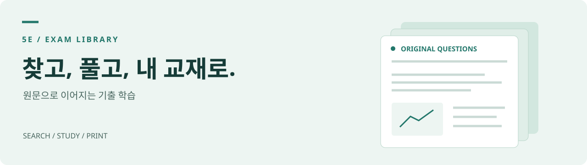
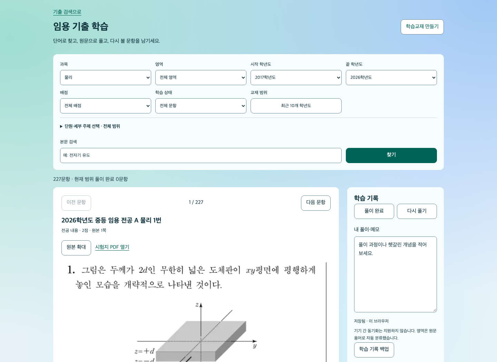

<p align="center">
  
</p>

<h1 align="center">5E 기출 탐색기</h1>

<p align="center">
  수능·모의평가·학력평가부터 과학 임용까지.<br>
  <b>원문 속 단어로 찾고, 원본을 보며 공부하는 기출 라이브러리.</b>
</p>

<p align="center">
  <a href="https://github.com/seungyeon980808-pixel/exam-search/tags"></a>
  <a href="LICENSE"></a>
  
</p>

<p align="center">
  <a href="https://www.5e.ai.kr/examlibrary/"><b>기출 검색 열기 ↗</b></a> ·
  <a href="https://www.5e.ai.kr/examlibrary/?view=study&amp;group=imyong"><b>임용 학습 모드 ↗</b></a> ·
  <a href="https://www.5e.ai.kr/print/?source=imyong">교재 만들기 ↗</a>
</p>

---

## 찾기에서 학습까지

| 하고 싶은 일 | 할 수 있는 것 |
| --- | --- |
| **필요한 기출 찾기** | 최대 세 단어의 본문 검색, 과목·학년도·시험·영역 필터, 검색 주소 복원 |
| **원문 확인하기** | 문항 이미지, 고해상도 원본 확대, 시험지 PDF와 출처 확인 |
| **과학 임용 공부하기** | 단원·세부 주제 복수 선택, 풀이 완료·다시 풀기, 개인 메모와 JSON 백업 |
| **내 범위로 교재 만들기** | 선택 범위를 [5E_print](https://github.com/seungyeon980808-pixel/print)에 전달해 제작 요청 만들기 |
| **문항을 모아 편집하기** | 지원 범위에서 문항 선택·모아 보기·HWPX 초안 편집. [변환 한계 확인](docs/EDITABLE.md) |

<p align="center">
  <a href="https://www.5e.ai.kr/examlibrary/?view=study&amp;group=imyong&amp;subject=t_physics&amp;yearFrom=2017&amp;yearTo=2026"></a><br>
  <sub>실제 공개 서비스의 임용 학습 모드 · 2026-11-10 촬영</sub>
</p>

## 바로 사용하기

1. [기출 탐색기](https://www.5e.ai.kr/examlibrary/)에서 시험 종류와 과목을 고릅니다.
2. `전자기 유도`, `유전`, `판구조론`, `개념변화`처럼 원문에 나오는 단어로 검색합니다. 여러 단어는 **한 문항에 모두 포함**되어야 합니다.
3. 학년도·시험·영역으로 좁히고, 문항 이미지와 원본 PDF를 확인합니다.
4. 임용은 [학습 모드](https://www.5e.ai.kr/examlibrary/?view=study&group=imyong)에서 풀이 기록을 남기거나, 선택 범위를 교재 제작으로 이어 갑니다.

웹 사용에는 설치나 방문자의 Google 로그인이 필요하지 않습니다. 학습 기록은 **현재 브라우저에 저장**되며 기기 간 동기화는 지원하지 않습니다. 기기를 옮길 때는 JSON 백업을 사용하세요.

## 수록 범위

| 자료 | 범위 | 문항 수 |
| --- | --- | ---: |
| 수능·6월·9월 모의평가 | 2007–2027학년도 · 과학탐구·사회탐구·국어·영어·수학 | 19,760 |
| 교육청 학력평가 | 3·4·5·7·10월 · 과학탐구 8과목 · 560개 시험지 | 11,200 |
| 중등 임용 | 2002–2026학년도 · 물리·화학·생물·지구과학 · 공식 1차 시험지 152개 | 2,588 |

2026-11-09 자료판 기준입니다. 임용의 **과학교육론은 네 과목에 포함된 문항을 모아 보는 영역**이므로 별도 문항 수로 더하지 않습니다. 학년도와 시행 연도는 다를 수 있습니다. 예를 들어 2027학년도 3월 학평은 2026년 3월 시행 시험입니다.

임용은 **30개 단원·72개 세부 주제**를 선택할 수 있습니다. 영역·주제는 원문 용어로 자동 분류한 학습용 태그이며 공식 출제영역을 확정한 분류가 아닙니다. 경계 문항은 본문 검색과 미분류에서도 확인해 주세요. [자료 출처와 분류 기준 →](docs/DATA.md)

## 임용 학습교재

[교재 제작 화면](https://www.5e.ai.kr/print/?source=imyong)에서 과목·영역·주제·학년도·배점·문항 수·정렬·제외어·풀이 여백을 정합니다. 기존 수능 제작과 같이 **설정과 제작 요청을 복사해 AI에게 전달하는 방식**이며, 서버에서 맞춤 PDF를 즉시 생성하지는 않습니다.

최근 10개년 **2017–2026학년도**의 완성 문제편 5종과 원문 확대본·문항표도 받을 수 있습니다. A3 가로에 **2점 4문항/쪽, 4점 2문항/쪽**으로 배치합니다. 네 과목의 중복 없는 문항은 867개이며 과학교육론 모음은 이 중 일부를 다시 모은 책입니다.

**현재 공개 PDF는 문제편입니다.** 해설·개념 옵션은 별도 작성·대조 단계에 전달하는 요청입니다. [임용 교재 안내 →](https://github.com/seungyeon980808-pixel/print/blob/main/docs/IMYONG.md)

## 로컬에서 실행하기

Node.js와 Python 3를 사용합니다. Node.js는 `node --test`와 `DecompressionStream`을 지원하는 환경을 사용하세요.

```bash
git clone https://github.com/seungyeon980808-pixel/exam-search.git
cd exam-search
npm ci
python3 -m http.server 8768 --bind 127.0.0.1
```

[http://127.0.0.1:8768/](http://127.0.0.1:8768/)에서 검색 화면을, `/?view=study&group=imyong`에서 학습 모드를 엽니다. 정적 웹앱이므로 별도 앱 서버나 번들 빌드는 없습니다. 고해상도 원문 PDF는 공개 게이트웨이에 접근할 수 있어야 열립니다.

```bash
npm test                  # 기본 단위 검사
npm run test:imyong        # 임용 색인 검사
npm run test:study         # 학습 기록·필터 검사
```

브라우저 검사 준비와 데이터 재생성은 [개발 안내](docs/DEVELOPMENT.md), 변경 제안은 [기여 안내](CONTRIBUTING.md)를 참고하세요.

## 저장소와 문서

```text
entry.mjs                     검색 / 학습 모드 진입점
app.js · search*.mjs           검색 화면과 본문 검색
study*.mjs · study.css         임용 학습 모드와 브라우저 학습 기록
imyong-topics.mjs              학습용 단원·세부 주제 선택
data/                         원본 색인과 브라우저용 목록·gzip 색인
cards/ · previews/             문항 이미지와 시험지 미리보기
drive-source.mjs               공개 원본 PDF 연결
editable-*.mjs · vendor/       편집 가능한 문항 초안
tools/ · test_*.mjs            데이터 생성 도구와 검사
docs/                         사용·데이터·운영 안내와 검수 기록
```

| 문서 | 내용 |
| --- | --- |
| [문서 안내](docs/README.md) | 사용·데이터·개발·검수 문서 찾아보기 |
| [데이터와 출처](docs/DATA.md) | 자료 범위, OCR·분류 한계, 원본 연결 |
| [개발과 배포](docs/DEVELOPMENT.md) | 로컬 검사, 색인 생성, GitHub Pages 운영 |
| [문항 편집](docs/EDITABLE.md) | 모아 보기, HWPX 초안, 글꼴·복원 한계 |
| [5E 저장소 구성과 버전](docs/REPOSITORIES.md) | 기출 탐색기·print·5E 본체의 역할과 버전 구분 |
| [변경 내역](CHANGELOG.md) · [제품 원칙](PRODUCT.md) · [설계](DESIGN.md) | 릴리스 기록과 구현 기준 |

## 문제 제보

[GitHub Issues](https://github.com/seungyeon980808-pixel/exam-search/issues)에 사용한 주소, 브라우저, 재현 순서와 문항 ID 또는 학년도·과목·번호를 남겨 주세요. 학습 메모와 백업에는 개인 기록이 들어갈 수 있으니 제보에 그대로 첨부하지 마세요.

## 라이선스와 출처

코드는 [AGPL-3.0](LICENSE), 포함된 외부 구성 요소는 [THIRD_PARTY.md](THIRD_PARTY.md)를 따릅니다. 원본 PDF·문항·이미지의 권리는 한국교육과정평가원·교육청 등 각 원저작자에게 있습니다. 코드 라이선스가 해당 자료의 재배포 권리를 부여하지는 않습니다.

개발 박승연 · 서울특별시교육청
